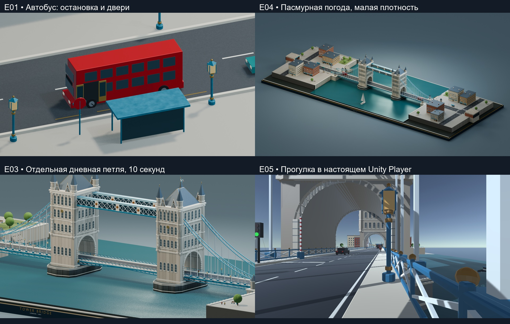

# Tower Bridge Blender

Редактируемая авторская диорама Тауэрского моста и двух лондонских берегов: транспорт останавливается перед разведением, парусник проходит между створками, движение возобновляется, а город переходит к сумеркам.

Текущие исходники — **v1.2.0**: 60 секунд, 24 кадра/с, 1440 кадров, 1920×1080. Основной план **B00–B27 и E01–E05 выполнен**. В комплект входит проверенный интерактивный прототип Unity для Windows: прогулка, управление мостом, камеры и время суток. [Релиз v1.2.0](https://github.com/trollyHUB/tower-bridge-blender/releases/tag/v1.2.0), [отчёт проверки](docs/IMPLEMENTATION_REPORT_v1.2.0.md), [что осталось](docs/REMAINING_WORK.md).


## Сцена

- Две башни, верхние переходы, подвесы и две створки с раскрытием до 68°.
- 14 автомобилей четырёх типов: двухэтажный автобус, такси, легковой автомобиль и грузовик; колёса, полосы, очередь, шлагбаумы и сигналы; повторный въезд машин через скрытые порталы.
- Восемь базовых зданий, два берега, улицы, набережные и причал.
- Десять идущих пешеходов с постановкой стоп, шесть ожидающих пассажиров и четыре посетителя кафе; парусник, низкий катер и две пришвартованные лодки. Аналитические волны согласованы с качкой судов; след остаётся в мировых координатах и затухает.
- Практические источники света, окна и 28 настоящих источников фар, плавный переход к сумеркам; общий ветер для волн, ткани и крон.
- Девять камер и монтажные маркеры, включая остановку автобуса; анимация сохраняется в обычном `.blend` без запуска скриптов и обработчиков при открытии.

Геометрия и процедурные материалы созданы для проекта. Сторонние FBX/GLB и платные модели не включены. Это художественная учебная реконструкция с упрощёнными размерами и декором; физическая симуляция жидкости не требуется.

## Открыть проект

Рабочая версия — Blender 5.2.1 LTS; совместимость с другими версиями требует отдельной проверки. Откройте `Tower_Bridge/Tower_Bridge.blend`, нажмите NumPad 0 и Пробел над Timeline. Кадр **1** показывает закрытый мост, **720** — открытый, **1440** — вечерний финал. Камера меняется по маркерам Timeline.

[Инструкция внутри комплекта](Tower_Bridge/НАЧНИТЕ%20ЗДЕСЬ.txt) описывает управление. Последний комплект доступен в [релизе v1.2.0](https://github.com/trollyHUB/tower-bridge-blender/releases/tag/v1.2.0); предыдущие выпуски сохранены отдельно. Для освещения переключите вид в **Rendered** или нажмите **F12**.


## Дополнения v1.2.0

- Автобус стоит у остановки две секунды, открывает двери и продолжает путь; кадры 352–407 основной сцены показывают эпизод.
- `Tower_Bridge/extensions/presentation/Tower_Bridge_Titled_Sound.mp4` — отдельный 60-секундный вариант с русскими титрами и оригинальным звуком.
- `Tower_Bridge/extensions/day_loop/` — бесшовная дневная водная петля 10 с и отдельный редактируемый `.blend`.
- `Tower_Bridge/extensions/weather/` — проверенные примеры погоды и плотности; [создание вариантов](docs/PRESETS.md).
- `Unity/` — исходный интерактивный проект; готовое Windows-приложение — в `Tower_Bridge_Unity_Windows.zip` релиза. [Управление и проверка](docs/UNITY.md).

[Медиа и пересчёт](docs/MEDIA.md) · [Заметки выпуска](docs/RELEASE_NOTES_v1.2.0.md)



## Разработка и пересчёт

Нужны Git LFS и Blender. После клонирования выполните `git lfs install --local` и `git lfs pull`: `.blend` хранится через LFS. Скрипты используют Python Blender, устанавливать `bpy` через pip не нужно.

Для внешних Python-инструментов изображений, proxy и проверки пикселей:
`python -m pip install -r requirements-dev.txt`. В файле зафиксированы
проверенные версии Pillow и NumPy; базовая сборка Blender обходится без них.

```powershell
./scripts/project.ps1 -Action Build
./scripts/project.ps1 -Action Finalize
./scripts/project.ps1 -Action Validate
python -m unittest discover -s tests -v
./scripts/project.ps1 -Action Preview
./scripts/project.ps1 -Action PreviewEncode
./scripts/project.ps1 -Action Benchmark
./scripts/project.ps1 -Action Stills
./scripts/project.ps1 -Action Animation -StartFrame 1 -EndFrame 1440
./scripts/project.ps1 -Action Encode
./scripts/project.ps1 -Action VideoCheck
python tools/package_release.py
```

При необходимости передайте `-BlenderPath 'D:\Apps\Blender\blender.exe'`. Build перезаписывает сцену: ручные изменения предварительно сохраните отдельно. Finalize выполняйте **до рендера**: изменение `.blend` меняет его хеш и делает предыдущий кеш несовместимым.

Финальная анимация использует Eevee; статика — Cycles с доступным CPU и необязательным GPU. Preview создаёт отдельный кеш пониженного разрешения, PreviewEncode — полный проверочный MP4. Кадры можно продолжать с выбранного диапазона; сцена, конфигурация, код рендера и профиль входят в идентификатор кеша. Подробнее: [порядок разработки](docs/DEVELOPMENT.md).

## Изображения

Шесть изображений v1.2.0 проверены по текущему SHA сцены, размерам и CRC.

Режим Stills создаёт `Tower_Bridge_Open.png`, `Tower_Bridge_Closed.png`, `Tower_Bridge_City.png`, `Tower_Bridge_Water.png`, `Tower_Bridge_Evening.png` и дополнительный `Tower_Bridge_Detail.png` в `Tower_Bridge/renders/`. Актуальность и визуальная приёмка фиксируются в отчёте.

## Структура

`config/scene.json` содержит общие настройки. `build_tower_bridge.py` собирает сцену, `scene_components/` содержит системы города, транспорта, воды, света, камер и проверок, `render_tower_bridge.py` выполняет рендер и кодирование. `tests/` содержит проверки без Blender, `scripts/project.ps1` — команды Windows, `tools/package_release.py` — проверяемую упаковку. `research/` хранит локальные кадры и логи и исключена из Git.

[Документация](docs/README.md) связывает сценарий, требования, архитектуру, задачи B00–B27 и критерии приёмки. E01–E05 добавляют остановку автобуса, звук и титры, дневную петлю, погоду/плотность и проверенное приложение Unity.

## Проверки и источники

Тесты без Blender проверяют расписание и транспорт, совместимость кеша и целостность PNG. Проверка Blender, визуальная приёмка, длительность и декодирование MP4 — отдельные этапы, состояние которых отражено в отчёте реализации.

Источники и ограничения перечислены в [SOURCES.txt](Tower_Bridge/SOURCES.txt) и [каталоге ресурсов](assets/SOURCES.md). Платный проект 3D Tudor не использован; полный видеоурок ранее не был доступен для просмотра. Лицензия проекта пока не выбрана.

## Развитие проекта


Четыре сопоставимых ракурса с одинаковыми камерами; [описание сравнения](docs/BEFORE_AFTER.md).


Исторический кадр извлечён из локального тега v0.1.0; камеры отличаются,
поэтому эта картинка показывает развитие, а не совпадающие ракурсы.
Полное финальное видео проверено. Выпускная копия `Tower_Bridge_ReviewProxy.mp4`
(уменьшение финальных 16-sample кадров; `review_proxy_validation.json`,
метод `downsample_final`) проверена: 1440 кадров, 24 fps, 480×270.
Переносимый ZIP проверен. Самостоятельный
4-sample Preview остаётся отдельной командой.
