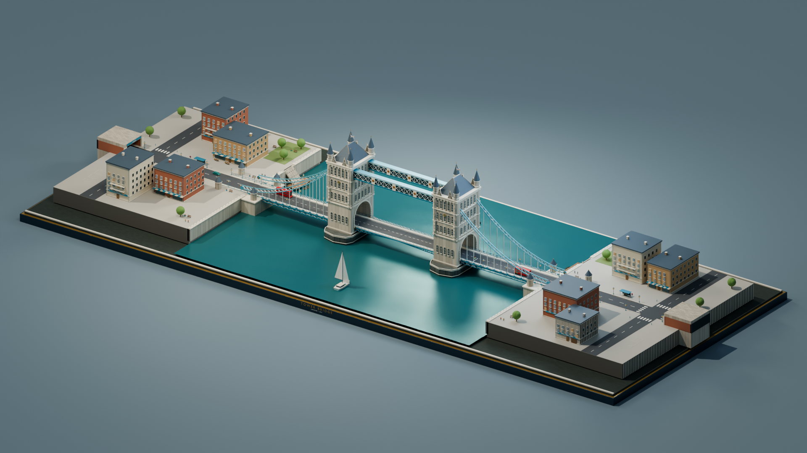
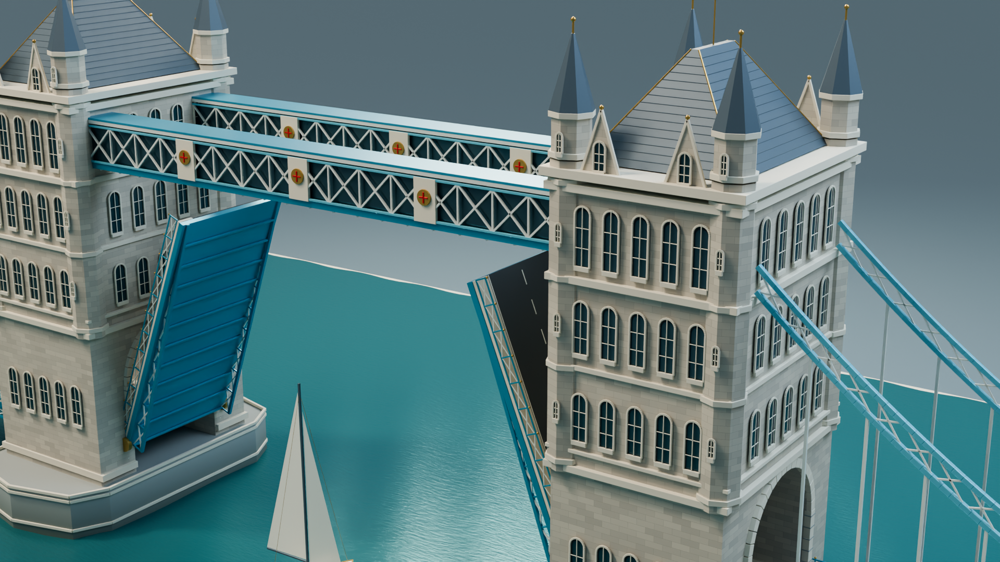

# Tower Bridge Blender

[](https://github.com/trollyHUB/tower-bridge-blender/actions/workflows/checks.yml)

Пет-проект: редактируемая диорама Тауэрского моста в Blender с процедурной геометрией, материалами и анимацией разведения. Следующее направление развития — городские кварталы, движение транспорта, улучшенная вода и вечернее освещение.


## Что уже работает

- Две башни с арочными проездами, окнами, крышами и угловыми шпилями.
- Два неподвижных верхних перехода и боковые подвесные конструкции.
- Две разводные створки с общим управлением углом раскрытия.
- Анимация на 720 кадров: 30 секунд при 24 кадрах/с.
- Проход парусника при открытом мосте и движение камеры.
- Процедурные материалы камня и анимированной поверхности воды.
- Дорога, перила, фонари, два статичных автобуса и основание диорамы.
- Четыре камеры и три готовых изображения 1920×1080.

В сцене 152 объекта, 137 mesh-объектов и 18 материалов. Автобусы и флаги пока неподвижны. Фонари имеют светящийся материал; отдельные источники света в них ещё не добавлены. Вода не использует физическую симуляцию жидкости.

Это художественная учебная реконструкция с упрощёнными размерами и декором. Геометрия создана скриптом: предоставленные для изучения FBX и GLB не включены в проект.

## Открыть готовый проект

Проверенная версия — **Blender 5.2.1 LTS**. Совместимость с другими версиями пока не проверялась.

1. Скачайте полный комплект из [релизов](https://github.com/trollyHUB/tower-bridge-blender/releases).
2. Откройте `Tower_Bridge/Tower_Bridge.blend` в Blender.
3. Нажмите **NumPad 0**, чтобы посмотреть через активную камеру.
4. Наведите указатель на Timeline и нажмите **Пробел**, чтобы запустить анимацию.

Кадр **1** — мост закрыт, **360** — открыт на 68°, **720** — закрыт. Подробное управление описано в [инструкции](Tower_Bridge/НАЧНИТЕ%20ЗДЕСЬ.txt) и в текстовом блоке «ПРОЧИТАЙТЕ | Управление проектом» внутри Blender.

Готовые **MP4 и ZIP публикуются в релизах**, а не в истории Git. Демонстрационное видео: 1280×720, 24 кадра/с, 30 секунд.

## Клонировать для разработки

Нужны Git и [Git LFS](https://git-lfs.com/). Файл `.blend` хранится через LFS.

```bash
git clone https://github.com/trollyHUB/tower-bridge-blender.git
cd tower-bridge-blender
git lfs install --local
git lfs pull
```

После загрузки откройте `Tower_Bridge/Tower_Bridge.blend`. Если вместо сцены скачался маленький текстовый файл, выполните `git lfs pull`.

## Структура репозитория

```text
.
├── build_tower_bridge.py         # Создание сцены с нуля
├── render_tower_bridge.py        # Рендер, видео и проверки сцены
├── Tower_Bridge/
│   ├── Tower_Bridge.blend        # Редактируемая сцена, Git LFS
│   ├── renders/                  # Три изображения для портфолио
│   ├── НАЧНИТЕ ЗДЕСЬ.txt         # Инструкция по работе в Blender
│   ├── SOURCES.txt               # Источники и примечания
│   └── *.json                    # Статистика и результаты проверок
├── scripts/project.ps1          # Запуск задач на Windows
├── tools/package_release.py     # Подготовка ZIP для релиза
├── docs/README.md               # Входная страница документации развития
├── docs/PROJECT_PLAN.md         # Подробный поэтапный план
├── docs/SCENARIO.md             # Сценарий будущего ролика
├── docs/DEVELOPMENT.md           # Работа с Git и сборка
├── docs/ROADMAP.md               # План развития
└── .github/workflows/checks.yml  # Проверка синтаксиса и JSON
```

Локальная папка `research/` содержит промежуточные кадры, логи, исследование и профиль Blender. Она полностью исключена из Git. Созданные видео, архивы и резервные копии Blender также исключены.

## Запуск задач

Скрипты используют встроенный Python Blender; устанавливать пакет `bpy` через pip не нужно.

В PowerShell из корня проекта:

```powershell
./scripts/project.ps1 -Action Validate
./scripts/project.ps1 -Action Stills
./scripts/project.ps1 -Action Animation -StartFrame 1 -EndFrame 720
./scripts/project.ps1 -Action Encode
```

Если Blender установлен в другом месте, передайте `-BlenderPath 'D:\Apps\Blender\blender.exe'`. Команды `Stills` и `Finalize` в текущей реализации используют OptiX; для них нужна совместимая NVIDIA. Готовая сцена сохранена с CPU как устройством Cycles и может открываться без настройки GPU.

Повторная сборка через `-Action Build` перезаписывает созданный `.blend`. Ручные изменения сцены предварительно сохраните под отдельным именем. Остальные режимы и порядок сборки описаны в [документации разработки](docs/DEVELOPMENT.md).

## Развитие

Ближайшие задачи — единая конфигурация сценария, транспорт с остановкой перед разводным мостом, два городских берега и вода со следом от судна. Затем — вечернее освещение и пешеходы. Основной будущий результат — 60-секундная демонстрация обычного движения, перекрытия, разведения, прохода судна и вечернего финала.

В [документации развития](docs/README.md) собраны [сводный ROADMAP](docs/ROADMAP.md), [полный поэтапный план](docs/PROJECT_PLAN.md), [сценарий](docs/SCENARIO.md), [требования](docs/REQUIREMENTS.md), [архитектура](docs/ARCHITECTURE.md), [очередь задач](docs/BACKLOG.md) и [критерии готовности](docs/ACCEPTANCE.md). Эти дополнения запланированы; текущая готовая сцена остаётся базовой 30-секундной версией.



<details>
<summary>Архитектурные детали</summary>



</details>

## Проверки

Для текущей сцены проверены симметричное движение створок, крайние и промежуточные положения, зазор под верхними переходами и кадрирование анимированной камеры. Готовый MP4 проверен по размеру, частоте кадров, длительности и декодированным кадрам.

GitHub Actions проверяет синтаксис Python и PowerShell и корректность JSON. Он не запускает Blender и не заменяет визуальную проверку сцены.

## Источники

- [Устройство Тауэрского моста](https://www.towerbridge.org.uk/stories/what-type-of-bridge-is-tower-bridge).
- [Архитектура моста](https://www.towerbridge.org.uk/stories/the-architectural-style-of-tower-bridge).
- [Верхние переходы и внутренние пространства](https://www.towerbridge.org.uk/explore-inside).
- [Диорама 3D Tudor как визуальный ориентир](https://3dtudor.gumroad.com/l/London_Bridge_Blender_Unreal_Engine).

Платный проект 3D Tudor не использован. Полный видеоурок не был просмотрен: расшифровка и воспроизведение были недоступны. Дополнительные примечания сохранены в `Tower_Bridge/SOURCES.txt`.

Лицензия проекта пока не выбрана.
