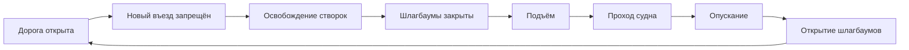

# Архитектура будущей реализации

Сборка должна оставаться воспроизводимой, а движение транспорта, моста и судов — согласованным при воспроизведении и переходе к любому кадру. Эта архитектура запланирована для этапа 1; новые модули и конфигурация ещё не созданы.

## Что есть сейчас

`build_tower_bridge.py` создаёт всю сцену одним скриптом. `render_tower_bridge.py` содержит режимы изображений, анимации, кодирования, проверки и финализации. `scripts/project.ps1` запускает эти задачи, `tools/package_release.py` собирает релиз.

Длительность 720 кадров повторяется в генераторе, рендере, контрольных точках, диапазоне PowerShell и проверке архива. GPU-функция рендера выбирает OptiX. Главные технические работы — согласовать параметры и сделать доступный CPU-режим без изменения источников сцены вручную.

## Предлагаемая структура

```text
config/project.json                 # fps, длительность, seed, качество и плотность
src/tower_bridge/
  scene.py                          # Сборка и именование компонентов
  bridge.py                         # Башни, пролёты, оси и управление
  city.py                           # Кварталы, дороги и набережные
  traffic.py                        # Модели транспорта и маршруты
  river.py                          # Вода, суда, качка и след
  people.py                         # Пешеходы и циклы движения
  lighting.py                       # Практический свет и время суток
  scenario.py                       # Расписание и согласование событий
  cameras.py                        # Рабочие виды и монтажные камеры
  validation.py                     # Проверки состояния и зазоров
assets/                             # Отдельные авторские библиотеки ресурсов
research/render_runs/<build_id>/     # Локальные кадры, настройки и логи сборки
Tower_Bridge/                        # Итоговая сцена и изображения
```

Корневые скрипты остаются входными точками, чтобы существующие команды работали после реорганизации. Новые файлы вводятся постепенно; одно изменение структуры не должно требовать одновременно завершить весь город.

## Единая конфигурация

Минимальный пример будущего файла:

```json
{
  "fps": 24,
  "duration_seconds": 60,
  "seed": 1894,
  "bridge_open_degrees": 68,
  "quality": "preview"
}
```

Количество кадров вычисляется из длительности и fps, а не хранится независимым противоречащим значением. Остальные настройки добавляются по мере реализации: транспорт, здания, параметры ветра и воды, интенсивность вечернего света.

Все части цепочки читают одну конфигурацию: генератор, сценарий, проверки, кодирование, PowerShell и упаковка. Контрольные кадры определяются фазами сценария. Разрешение определяется профилем качества; метаданные видео сверяются с выбранным профилем.

## Пространство и компоненты

X направлен вдоль дороги, Y — вдоль основного речного маршрута, Z — вверх. Масштаб — метры. В начале реорганизации проверить исходные трансформации объектов и зафиксировать границы:

- подвижные пролёты и дополнительный зазор;
- дуги движения шлагбаумов;
- стоп-линии и накопление очереди;
- судовой проход и зона ожидания;
- пешеходные маршруты и запретные участки.

У каждого актора есть стабильное имя или ID, габариты, маршрут и параметры движения. Колёса принадлежат транспорту; ограждения и балки створки принадлежат её оси. Верхние переходы и башни остаются частью неподвижной конструкции.

## Расписание работы моста



Для каждой фазы определить начало, конец и допустимые действия акторов. Переходы сопровождаются условиями: нет транспорта и людей на створках; барьеры достигли закрытого положения; проход судна имеет достаточный зазор; судно покинуло зону опускания; дорога закрылась до открытия движения.

В Blender основной результат — заранее рассчитанная и проверенная анимация. Планировщик формирует маршруты и ключи по расписанию. Если условия не выполнены, сборка сообщает о несогласованном сценарии, который нужно исправить до рендера. Реакция на произвольные действия пользователя относится к последующей интерактивной версии.

Существующее свойство `BRIDGE CONTROL | Opening degrees` можно сохранить как понятный интерфейс угла. Расписание должно согласованно формировать его ключи и движение остальных акторов, вместо независимого редактирования каждого объекта.

## Движение акторов

Положение актора определяется сценарием и текущим кадром, а не накоплением перемещения при каждом обновлении окна. Проверка кадра после прямого перехода должна давать тот же результат, что последовательное воспроизведение.

Транспорт использует расстояние вдоль маршрута. Остановка и очередь учитывают длину кузова и минимальный промежуток. Поворот колёс связан с пройденным расстоянием и фактическим радиусом после учёта масштаба: угол в радианах равен расстоянию, делённому на радиус.

Судно имеет собственный маршрут, габариты и высоту над водой. Качка накладывается с ограниченной амплитудой; она не должна нарушать зазор. След получает положение и скорость судна. Пешеходы используют отдельные маршруты, а движение тела согласуется с циклом ходьбы.

## Источники геометрии и ручная отделка

Процедурно строить расположение, повторения и базовую геометрию. Детали, которые удобнее редактировать руками, хранить отдельными авторскими библиотеками в `assets/`. Сборка подключает их, но не перезаписывает исходный ресурс.

Все зависимости использовать с относительными путями, включать необходимые ресурсы в полный комплект и проверять открытие из другой папки. При появлении внешних ресурсов добавить `assets/SOURCES.md` с автором, ссылкой, условиями использования и описанием изменений.

Ручная правка итогового `.blend` остаётся допустимой, но должна иметь определённый способ переноса в повторную сборку. Не считать перезапись такого файла полноценным сохранением ручной работы.

## Вода и свет

Для воды разделить мелкий шейдерный рельеф, крупное движение поверхности и локальный след судна. Все три уровня используют согласованные масштаб, время и направление течения. Не связывать качество всей реки с дорогостоящим расчётом жидкости без необходимости.

Для света различать видимое свечение материала и источник, освещающий поверхность. Источники возле камер и ключевых объектов получают нужные тени; дальние огни могут быть проще. Время суток управляет общим освещением, фонарями, окнами и фарами.

## Рендер и продолжение расчёта

Предлагаемые профили:

| Профиль | Назначение | Принцип |
| --- | --- | --- |
| Рабочий | Размещение и просмотр движения | Упрощённые материалы, умеренная детализация |
| Проверочный | Весь ролик и синхронизация | Eevee, облегчённое разрешение, достаточная читаемость |
| Итоговый | Видео и изображения | Настройки после пробных кадров; Eevee для видео при достаточном качестве, Cycles для статики и нужных крупных планов |

Сборка кадров сохраняет манифест: версия или commit, конфигурация, выбранный профиль, fps, диапазон и сведения о ресурсах. Возобновлять рендер разрешается только для совместимой сборки. Изменение сцены создаёт новую папку либо явно пересчитывает необходимые кадры.

Перед кодированием проверять наличие всех кадров и одинаковый размер. После кодирования сверять длительность, частоту, разрешение и декодировать контрольные точки. Упаковка читает реальные метаданные и включает библиотеки ресурсов, если они появились.

## Подготовка к последующему экспорту

Сохранять раздельные подвижные створки, чистые оси и понятные размеры. Для пробного переноса в Unity отдельно проверить запечённую анимацию, материалы, масштаб и зависимости. Такая подготовка не означает, что Blender-драйверы и процедурные материалы автоматически перенесутся без адаптации.
