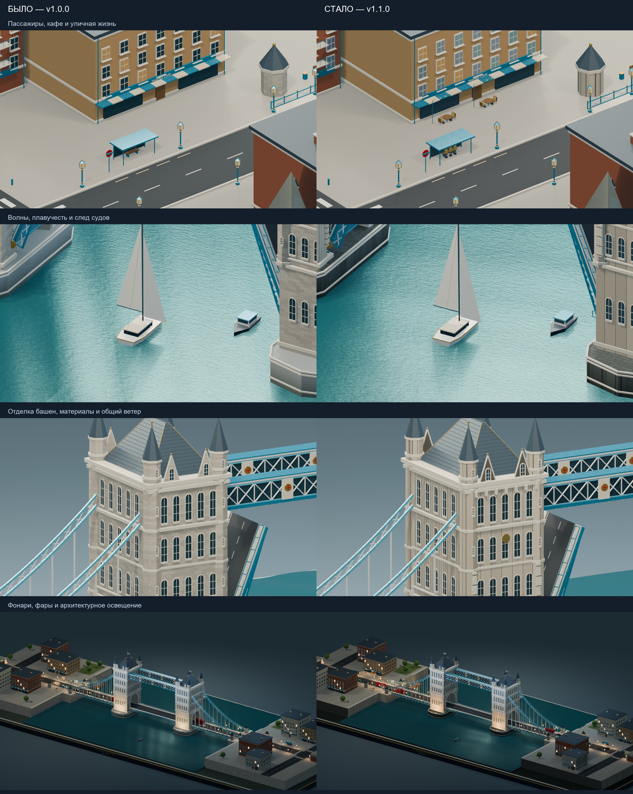
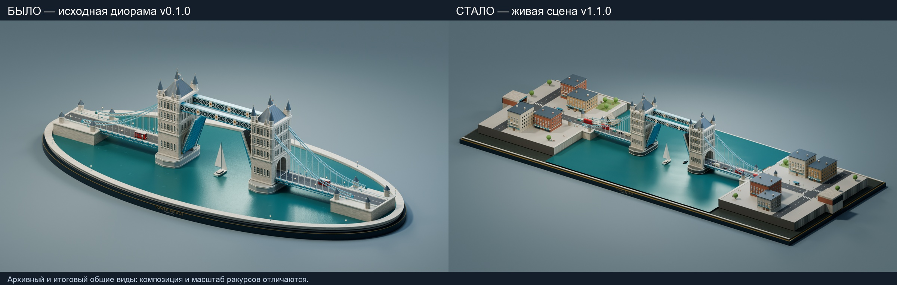

# До и после: v1.0.0 → исходники v1.1.0

Сравнение относится к реализации в коде. Основная сцена, A03, новые изображения и воспроизводимость
проверены; полный финальный ролик и переносимый комплект ещё ожидаются.
Результаты v1.1.0 — в [новом отчёте](IMPLEMENTATION_REPORT_v1.1.0.md). Результаты v1.0.0 сохранены в
[отчёте](IMPLEMENTATION_REPORT.md).

| Область | v1.0.0 | Исходники v1.1.0 |
| --- | --- | --- |
| Настройки | Общая длительность и профили; часть художественных параметров задана в коде | Применяемые и проверяемые параметры транспорта, людей, воды, ветра и света |
| Транспорт | Конечный проезд и очередь | Повторный въезд через скрытые порталы; накопленный путь колёс |
| Ходьба | Условное движение конечностей | Двухзвенные ноги, опорная фаза стоп, перенос ноги по пройденному расстоянию и индивидуальные детерминированные фазы шага и рук |
| Люди | Десять идущих пешеходов | Те же десять плюс шесть ожидающих пассажиров и четыре сидящих посетителя кафе |
| Зазор при разведении | Выявлено пересечение корневых перил поднятой створки с туннелем башни | Расширены туннель и арка; перила отступают от шарнира и конца створки, неподвижные ограждения вынесены наружу. Полная повторная проверка A03 пройдена на 1440 кадрах (с оговорённым исключением механического узла) |
| Ветер | Отдельные колебания окружения | Общие направление, сила и временная фаза для волн, ткани и крон |
| Вода и качка | Процедурные волны и качка | Общая аналитическая поверхность для геометрии воды и поз судов |
| След | Стилизованный след у судна | Исторические участки в мировых координатах, дрейф, рост и затухание по возрасту |
| Причалы | Причалы и речные маршруты | Дополнительно две пришвартованные лодки, сваи и декоративные линии |
| Фары | Светящиеся материалы | Дополнительно по два SPOT-источника на машину, всего 28 |
| Свет | Сумерки и практические фонари | Мощности и режим суток применяются из конфигурации |
| Артефакты | Проверенный опубликованный комплект | Сцена и шесть PNG проверены; видео и переносимый комплект готовятся |

Это художественная учебная модель. Полная физика воды, ткани и швартовов,
непрерывное доказательство отсутствия столкновений между кадрами и бесшовная
петля не заявляются. E01–E05 остаются будущими задачами.

[Подробные заметки версии](RELEASE_NOTES_v1.1.0.md)

Геометрическое исправление и индивидуальные фазы присутствуют в исходниках.
Полные отчёты текущей сцены и A03 подтверждены для SHA, указанного в новом
отчёте; финальные видео, переносимость и выпуск ещё ожидаются.

## От первой версии к текущей

Первый кадр получен из локального Git-тега v0.1.0 и сохранён как
`assets/history/v0.1.0_Open.png`; происхождение фиксируется в
`Tower_Bridge/evolution_validation.json`. **Камеры первой и текущей версий
различаются**: это обзор развития проекта, а не сопоставление с одинаковой
камерой. В сравнении v1.0.0 → v1.1.0 выше используются четыре совпадающих
ракурса (`comparison_validation.json`). Обе картинки не подтверждают
готовность полного финального видео или публикации.
